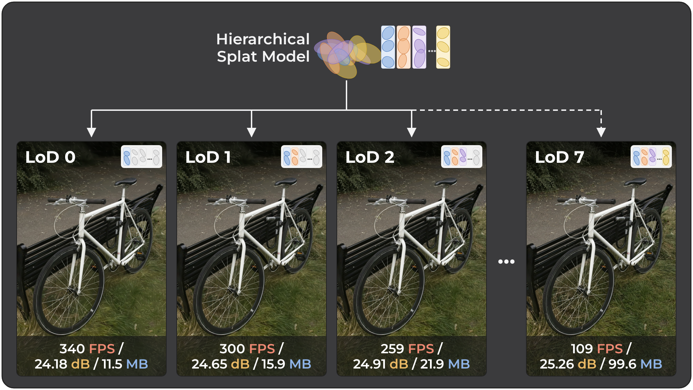
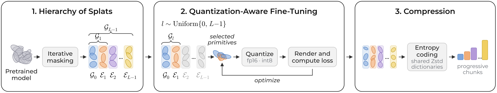

<div align="center">

# GoDe: Gaussians on Demand for Backbone-Agnostic Progressive Compression

**WACV 2027**

[Francesco Di Sario](https://scholar.google.com/citations?user=wjOMl_8AAAAJ)<sup>1,2</sup> ·
[Riccardo Renzulli](https://scholar.google.com/citations?user=JlAby_oAAAAJ)<sup>1</sup> ·
[Marco Grangetto](https://scholar.google.com/citations?user=Pt1gmQYAAAAJ)<sup>1</sup> ·
[Akihiro Sugimoto](https://scholar.google.com/citations?user=r7ZaWDUAAAAJ)<sup>2</sup> ·
[Enzo Tartaglione](https://scholar.google.com/citations?user=uKuvN64AAAAJ)<sup>3</sup>

<sup>1</sup>University of Turin · <sup>2</sup>National Institute of Informatics, Tokyo · <sup>3</sup>Télécom Paris, Institut Polytechnique de Paris

[](https://gaussians-on-demand.github.io/)
[](https://arxiv.org/abs/2501.13558)
[](https://arxiv.org/abs/2501.13558)
[](LICENSE)

</div>



GoDe turns a trained splat-based radiance field into **one progressive, compressed file**: any prefix of it decodes
to a complete model, from a few MB up to full quality. The same code runs on five backbones.

## Method



1. **Hierarchy.** Primitives are ranked by accumulated gradients and masked out level by level: a base layer 𝒢₀ and
   enhancement layers ℰ₁ … ℰ_{L−1}, each level a subset of the next.
2. **One fine-tuning.** All levels share one set of parameters; each iteration samples a level and renders it with
   simulated quantization (float16 geometry, int8 appearance).
3. **Progressive coding.** Each layer is a chunk compressed with shared Zstandard dictionaries; a level is decoded by
   concatenating its chunks.

## Installation

```shell
git clone https://github.com/gaussians-on-demand/GoDe.git
cd GoDe/backbones/<backbone>
```

Each backbone has its own environment (Python 3.10, PyTorch 2.5.1, CUDA 12.1) and ships its CUDA rasterizers in
`submodules/`; nothing else is downloaded. The common part:

```shell
conda create -y -n gode-<backbone> python=3.10 && conda activate gode-<backbone>
pip install torch==2.5.1 torchvision==0.20.1 --index-url https://download.pytorch.org/whl/cu121
pip install -r requirements.txt
```

then, from the backbone's folder:

| Backbone | Folder | Then run |
|---|---|---|
| 3DGS-MCMC | [`backbones/3dgs-mcmc`](backbones/3dgs-mcmc) | `pip install submodules/diff-gaussian-rasterization submodules/simple-knn` |
| Scaffold-GS | [`backbones/scaffold-gs`](backbones/scaffold-gs) | `pip install torch-scatter==2.1.2 -f https://data.pyg.org/whl/torch-2.4.0+cu121.html`<br>`pip install submodules/scaffold-diff-gaussian-rasterization submodules/simple-knn` |
| Octree-GS | [`backbones/octree-gs`](backbones/octree-gs) | `pip install torch-scatter==2.1.2 -f https://data.pyg.org/whl/torch-2.4.0+cu121.html` |
| Triangle Splatting | [`backbones/triangle-splatting`](backbones/triangle-splatting) | `pip install submodules/diff-triangle-rasterization submodules/simple-knn` |
| Spherical Voronoi | [`backbones/spherical-voronoi`](backbones/spherical-voronoi) | `pip install -e .`<br>`pip install -e submodules`<br>`pip install -e submodules/spherical-voronoi` |

Octree-GS needs the stock `gsplat` and Spherical Voronoi its Beta-kernel variant, so keep them in separate
environments.

## Data

| Dataset | Download |
|---|---|
| Mip-NeRF 360 | [jonbarron.info/mipnerf360](https://jonbarron.info/mipnerf360) |
| Tanks & Temples, Deep Blending | [tandt_db.zip](https://repo-sam.inria.fr/fungraph/3d-gaussian-splatting/datasets/input/tandt_db.zip) |

```
$DATA_ROOT/nerf_real_360/{bicycle,garden,...}
$DATA_ROOT/tandt/{train,truck}
$DATA_ROOT/db/{drjohnson,playroom}
```

Mip-NeRF 360 indoor scenes use `images_2`, outdoor ones `images_4`.

## Running GoDe

Two stages, from the backbone's folder: **train** the backbone (or bring your own checkpoint), then **build and
compress** the hierarchy with `scalable_train.py`. For example, with 3DGS-MCMC on *bonsai*:

```shell
python train.py --config configs/bonsai.json --eval --images images_2 \
  -s $DATA_ROOT/nerf_real_360/bonsai -m output/bonsai

python scalable_train.py --config configs/bonsai.json --images images_2 \
  -s $DATA_ROOT/nerf_real_360/bonsai -m output/gode/bonsai \
  --checkpoint output/bonsai/point_cloud/iteration_30000/point_cloud.ply \
  --num_levels 8 --hier_min 150000 --sample_level_ratio 1.1 \
  --ft_iterations 30000 --save_images
```

<details>
<summary><b>Scaffold-GS</b></summary>

```shell
python train.py --eval --images images_2 \
  -s $DATA_ROOT/nerf_real_360/bonsai -m output/bonsai

python scalable_train.py --images images_2 \
  -s $DATA_ROOT/nerf_real_360/bonsai -m output/gode/bonsai \
  --checkpoint output/bonsai/point_cloud/iteration_30000 \
  --num_levels 8 --hier_min 50000 --sample_level_ratio 1.1 \
  --ft_iterations 30000 --save_images
```
</details>

<details>
<summary><b>Octree-GS</b></summary>

```shell
python train.py --config config/scaffoldgs/lod_model.yaml \
  --source_path $DATA_ROOT/nerf_real_360/bicycle \
  --scene_name bicycle --dataset_name mipnerf360

python scalable_train.py --config config/scaffoldgs/lod_model.yaml \
  --source_path $DATA_ROOT/nerf_real_360/bicycle \
  --model_path output/gode/bicycle \
  --checkpoint output/bicycle/point_cloud/iteration_40000 \
  --num_levels 8 --hier_min 50000 --sample_level_ratio 1.1 \
  --ft_iterations 30000 --save_images
```

The checkpoint directory holds `point_cloud.ply` and the MLP checkpoints, which every level shares.
</details>

<details>
<summary><b>Triangle Splatting</b></summary>

```shell
python train.py --config config/indoor.json --scene bonsai --eval \
  -s $DATA_ROOT/nerf_real_360/bonsai -m output/bonsai

python scalable_train.py --config config/indoor.json --scene bonsai --eval \
  -s $DATA_ROOT/nerf_real_360/bonsai -m output/gode/bonsai \
  --checkpoint output/bonsai/point_cloud/iteration_30000 \
  --num_levels 8 --hier_min 150000 --sample_level_ratio 1.1 \
  --ft_iterations 30000 --save_images
```
</details>

<details>
<summary><b>Spherical Voronoi</b></summary>

```shell
python train.py --config config/indoor.json --scene bonsai \
  -s $DATA_ROOT/nerf_real_360/bonsai -m output/bonsai \
  --color_rep voronoi --num_lobes 7

python scalable_train.py --config config/indoor.json --scene bonsai \
  -s $DATA_ROOT/nerf_real_360/bonsai -m output/gode/bonsai \
  --checkpoint output/bonsai/point_cloud/iteration_30000/point_cloud.ply \
  --color_rep voronoi --num_lobes 7 \
  --num_levels 8 --hier_min 150000 --sample_level_ratio 1.1 \
  --ft_iterations 30000 --save_images
```
</details>

**Whole benchmarks** (every backbone except Octree-GS ships these scripts):

```shell
DATA_ROOT=/path/to/datasets scripts/train_mipnerf360.sh      # stage 1
DATA_ROOT=/path/to/datasets scripts/scalable_mipnerf360.sh   # stage 2
python tools/make_results_table.py --run_root output/gode    # one table, per scene and per dataset
```

**Main options of `scalable_train.py`:** `--num_levels` (levels in the file), `--hier_min` (size of the coarsest
level), `--sample_level_ratio` (level sampling during fine-tuning: `1` uniform, `>1` favours fine levels),
`--ft_iterations`, `--save_images`. Each backbone's README lists them all, with the ablations.

**Output:**

```
output/gode/<scene>/
├── masks.pt                      level masks
├── scalable_results.csv          PSNR, SSIM, LPIPS, primitives, size, FPS and decoding time, per level
└── iter_30000/
    ├── zstd_dict.pkl             dictionary shared by every chunk
    ├── lod_0.zst ... lod_7.zst   the chunks, coarsest first
    └── renders/lod_*/            decoded test renders (--save_images)
```

The core's tests need neither a GPU nor a dataset: `pytest gode/tests`, from the repository root.

## Adding a backbone

`gode/` never touches primitives directly: implement its interface (rendering, primitive indexing, gradient scores,
loss, `encode_payload` / `decode_payload`) on your model class and point a copy of `scalable_train.py` at it. The
full list is in [`backbones/spherical-voronoi/README.md`](backbones/spherical-voronoi/README.md#porting-gode-to-another-backbone);
[`scene/beta_model.py`](backbones/spherical-voronoi/scene/beta_model.py) is a reference implementation.

## Citation

```bibtex
@article{disario2026gode,
  title   = {GoDe: Gaussians on Demand for Backbone-Agnostic Progressive Compression},
  author  = {Di Sario, Francesco and Renzulli, Riccardo and Grangetto, Marco and
             Sugimoto, Akihiro and Tartaglione, Enzo},
  journal = {arXiv preprint arXiv:2501.13558},
  year    = {2026}
}
```

## License and acknowledgements

The core (`gode/`) is MIT-licensed. Each backbone keeps the licence of the project it derives from — see the licence
files and `UPSTREAM.md` in its folder; several are under the Gaussian-Splatting License (research use only). GoDe
builds on [3D Gaussian Splatting](https://github.com/graphdeco-inria/gaussian-splatting),
[3DGS-MCMC](https://github.com/ubc-vision/3dgs-mcmc), [Scaffold-GS](https://github.com/city-super/Scaffold-GS),
[Octree-GS](https://github.com/city-super/Octree-AnyGS),
[Triangle Splatting](https://github.com/trianglesplatting/triangle-splatting),
[Beta Splatting](https://github.com/RongLiu-Leo/beta-splatting),
[Spherical Voronoi](https://github.com/sphericalvoronoi/sphericalvoronoi),
[gsplat](https://github.com/nerfstudio-project/gsplat) and [lpips-pytorch](https://github.com/S-aiueo32/lpips-pytorch).
